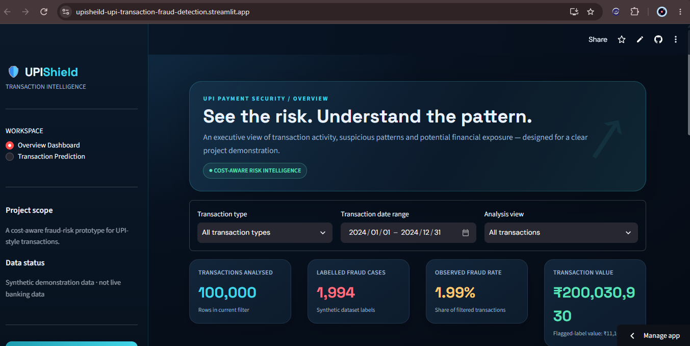
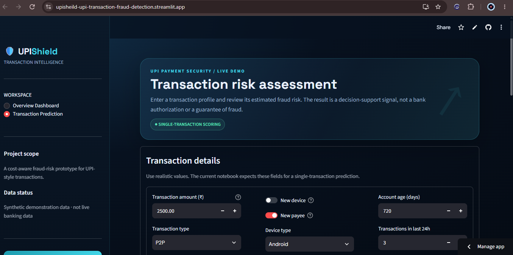

<div align="center">

# 🛡️ UPI-Shield — UPI Transaction Fraud & Risk Prediction

**End-to-end machine learning project: from raw transaction data to a deployed, interactive fraud-risk app.**

[](https://upisheild-upi-transaction-fraud-detection.streamlit.app/)


### 👉 [Try the live app](https://upisheild-upi-transaction-fraud-detection.streamlit.app/)

</div>

---

## 👋 For Recruiters & Hiring Managers (30-second summary)

| | |
|---|---|
| **What it is** | A cost-aware fraud-risk system for UPI-style payments: data analysis, ML modelling, and a deployed web app |
| **Problem solved** | Flag risky UPI transactions while balancing the business cost of missed fraud vs. false alarms |
| **Scale** | 100,000 transactions analysed, with about 2% labelled fraud (a realistic class-imbalance problem) |
| **Delivered** | Cleaned data → feature engineering → EDA → 3 models compared → cost-based threshold → risk levels → live app |
| **Roles it supports** | Data Analyst · Data Scientist / ML Engineer (entry-level) · Python Developer |

---

## 📸 Screenshots

### Overview Dashboard
Executive view of transaction activity, fraud rate and financial exposure, with filters for transaction type, date range and analysis view.



### Transaction Risk Assessment
Enter a transaction profile (amount, type, device, payee, account age, recent activity) and get an estimated fraud risk.



---

## 🎯 Problem Statement

UPI processes billions of payments every month, and even a small fraud rate causes large financial loss and loss of customer trust. Fraud is rare, so plain accuracy is misleading: a model that predicts "legit" every time is about 98% accurate and completely useless.

UPI-Shield tackles this with two ideas:

1. **Imbalance-aware modelling**: judge models by fraud-focused metrics, not just accuracy.
2. **Cost-aware decision threshold**: choose the cut-off by the business cost of missing a fraud vs. wrongly blocking a genuine payment, instead of the default 0.5.

---

## ✨ Key Features

- 📊 **Overview Dashboard**: KPIs (transactions analysed, labelled fraud cases, observed fraud rate, total transaction value) with interactive filters
- 🔍 **Single-Transaction Prediction**: real-time fraud-risk scoring from a transaction profile
- 🧠 **Multiple models compared** in one notebook to pick the best performer
- 💰 **Cost-based threshold tuning** that reflects business impact
- 🚦 **Risk levels** that turn a raw probability into an actionable signal
- 🚀 **Deployed on Streamlit Community Cloud**, so anyone can use it with no setup

---

## 🧰 Tech Stack

| Area | Tools |
|---|---|
| Language | Python |
| Data analysis | Pandas, NumPy |
| Visualisation | Matplotlib / Seaborn / Plotly *(keep the ones you used)* |
| Machine learning | Scikit-learn *(list your 3 models below)* |
| App & deployment | Streamlit, Streamlit Community Cloud |
| Tools | Jupyter Notebook, VS Code, Git & GitHub |

---

## 🔬 Methodology

```
Synthetic UPI data (100K rows)
        ↓
Data cleaning & validation
        ↓
Feature engineering (new device, new payee, account age, 24h activity, ...)
        ↓
Exploratory Data Analysis (EDA)
        ↓
Train & compare 3 models
        ↓
Cost-based threshold selection
        ↓
Risk levels (Low / Medium / High)
        ↓
Save model (.pkl) → Streamlit app → Live deployment
```

### Model comparison

> ✏️ **Fill this in from your notebook output.** A real results table is one of the strongest things a recruiter can see.

| Model | Precision | Recall | F1-score | ROC-AUC |
|---|---|---|---|---|
| Model 1 (e.g., Logistic Regression) | – | – | – | – |
| Model 2 (e.g., Random Forest) | – | – | – | – |
| Model 3 (e.g., XGBoost / Gradient Boosting) | – | – | – | – |

**Selected model:** _name_ — _one line on why (e.g., best recall at acceptable precision with lowest total cost)_.

---

## 📂 Project Structure

```
upi-fraud-risk-prediction/
├── app.py                           # Streamlit app (dashboard + prediction pages)
├── UPI_Fraud_Risk_Prediction.ipynb  # Full workflow: cleaning → EDA → models → threshold
├── generate_data.py                 # Script that simulates the dataset
├── upi_transactions_india.csv       # 100,000 synthetic UPI-style transactions
├── upi_fraud_model.pkl              # Trained model
├── feature_names.pkl                # Feature order expected by the model
├── threshold_info.pkl               # Cost-optimised decision threshold
├── requirements.txt                 # Dependencies
└── assets/                          # Screenshots used in this README
```

---

## ⚙️ Run Locally

```bash
# 1. Clone the repository
git clone https://github.com/NikhilJadhav07/upi-fraud-risk-prediction.git
cd upi-fraud-risk-prediction

# 2. Create and activate a virtual environment
python -m venv venv
venv\Scripts\activate          # Windows
# source venv/bin/activate     # macOS / Linux

# 3. Install dependencies
pip install -r requirements.txt

# 4. (Optional) Regenerate the dataset
python generate_data.py

# 5. Launch the app
streamlit run app.py
```

To explore the full analysis and modelling, open `UPI_Fraud_Risk_Prediction.ipynb` and click **Run All**.

---

## ⚠️ Important: About the Data

Real transaction-level fraud data is confidential, so this project uses a **synthetic dataset** of 100,000 UPI-style transactions (Indian states, banks, rupee amounts, UPI transaction types). Fraud labels are generated from known risk signals plus random noise, and `generate_data.py` shows exactly how.

- Results demonstrate the **method and engineering workflow**, not real-world fraud performance.
- The app output is a **decision-support signal**, not a bank authorisation or a guarantee of fraud.
- The pipeline is built so that real labelled data with the same column names can be dropped in.

---

## 💡 Skills Demonstrated

| Skill | Where it shows up |
|---|---|
| **Data Analysis** | Cleaning, EDA, KPI dashboard, filtering by type and date |
| **Machine Learning** | Imbalanced classification, multi-model comparison, threshold tuning |
| **Business Thinking** | Cost-aware decisions: fraud loss vs. false-alarm cost |
| **Python Development** | Modular scripts, data generation, model serialisation, clean app code |
| **Deployment** | Production-style Streamlit app on a public URL |
| **Communication** | Clear documentation, honest data disclosure, visual storytelling |

---

## 🚀 Future Improvements

- Add model explainability (SHAP) to show why a transaction was flagged
- Batch scoring via CSV upload
- Experiment with SMOTE / class weighting and hyperparameter tuning
- Model monitoring and drift checks
- Add unit tests and a CI workflow

---

## 👨‍💻 Author

**Nikhil Jadhav**
B.E. in Artificial Intelligence & Data Science · Data Analyst Intern, Code B, Nashik

🔗 [LinkedIn](https://www.linkedin.com/in/YOUR-USERNAME) · 💻 [GitHub](https://github.com/NikhilJadhav07) · 📧 your.email@example.com

Open to entry-level roles in **Data Analytics, Data Science / ML, and Python Development**.

---

<div align="center">

⭐ If you found this project useful, please consider giving it a star!

</div>
